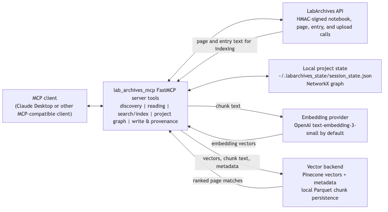

# 1. Overview

Electronic Lab Notebooks (ELNs) store protocols, observations, analysis notes, and audit records that AI assistants cannot inspect unless a tool exposes those records with authentication and a defined schema. Large Language Model (LLM) clients can call external tools, but the tool boundary must preserve notebook permissions and record provenance.

`lab_archives_mcp` addresses this gap by providing a Model Context Protocol (MCP) server that connects AI assistants to LabArchives, a widely used commercial ELN [@labarchives].
The server exposes notebooks, pages, and entries as typed tools, provides a modular vector backend for semantic search, and maintains persistent project contexts with graph-based provenance tracking. LabArchives was selected as the integration target because it has a documented API and a hierarchy of notebooks, pages, entries, and folders that maps directly to MCP navigation tools. The result is a system that allows AI assistants to navigate notebooks, perform concept-level search, maintain multi-session project contexts, and archive computational outputs with provenance metadata, without duplicating ELN records outside institutional infrastructure.

The intended users are wet-lab researchers, research data management teams, and institutional platform engineers who want to make ELN content available to AI assistants. The main contributions are (i) an MCP-based connector for LabArchives that can serve as a template for other ELNs and Laboratory Information Management Systems (LIMS), (ii) a reusable vector search backend that can be adopted independently of LabArchives for institutional retrieval-augmented generation (RAG) workflows, and (iii) a graph-based state management layer that models research context as a persistent network of pages and findings.

# 2. Implementation and Architecture

`lab_archives_mcp` is organized into six primary components that separate authentication, API access, MCP integration, semantic search, persistent state management, and upload/provenance tracking. This modular structure is intended to support both direct reuse and adaptation to other ELNs.



**Figure 1.** Component and data-flow architecture of the MCP integration. An MCP client calls the FastMCP server tools, which mediate LabArchives API access, local project-state updates, embedding requests, vector-index writes, and ranked search-result retrieval.

1. **Authentication layer (`auth.py`)**
   - Implements HMAC-SHA512 request signing for the LabArchives REST API [@labarchives].
   - Manages secure credential loading from configuration files or environment variables.
   - Provides user ID (UID) resolution flows based on temporary password tokens or browser-based login.

2. **API client (`eln_client.py`)**
   - Wraps the LabArchives API using an async HTTP client.
   - Provides methods for listing notebooks, traversing page hierarchies, and reading entries.
   - Translates XML responses into validated JSON using Pydantic models, ensuring consistent schemas for notebooks, pages, and entries [@pydantic].

3. **MCP server (`mcp_server.py`)**
   - Exposes notebook operations as MCP tools using the FastMCP framework [@fastmcp].
   - Publishes self-describing tool schemas so AI assistants can autonomously decide when and how to call them.
   - In `v0.4.0`, `mcp_server.py` registers 18 MCP tools by default. The tool surface has five user-facing categories: discovery (`list_labarchives_notebooks`, `list_notebook_pages`), reading (`read_notebook_page`), search and indexing (`search_labarchives`, `sync_vector_index`), project state and graph navigation (`create_project`, `list_projects`, `switch_project`, `delete_project`, `log_finding`, `get_current_context`, `get_related_pages`, `trace_provenance`, `suggest_next_steps`, `export_provenance_jsonld`), and write & provenance (`write_notebook_entry`, `upload_to_labarchives`). `write_notebook_entry` writes a rich text entry directly to a LabArchives page, appending to an existing page or creating a page when `page_id` is omitted. `upload_to_labarchives` uploads a file to LabArchives with code provenance metadata, creating a page and storing the file as page text or an attachment. The `get_onboard_payload` support tool returns usage guidance for MCP clients. Setting `LABARCHIVES_ENABLE_UPLOAD=false` disables the two write & provenance tools, leaving a 16-tool read/search/state surface.

4. **Vector backend (`vector_backend/`)**
   - Implements a configuration-driven pipeline for semantic search.
   - Uses OpenAI embeddings, Pinecone indexing, and local Parquet persistence in the implemented path.
   - Keeps Qdrant and local embeddings as extension points; the current `QdrantIndex` and `LocalEmbedding` classes raise `NotImplementedError`.
   - Uses Hydra-based configuration so that chunking parameters, model choices, and storage backends are declared in YAML rather than hard-coded [@hydra].
   - The `sync_vector_index` tool uses a persisted build record to decide between skipping, incrementally updating, or fully rebuilding an index when embedding configurations or model versions change, enabling reproducible and efficient maintenance of large notebook indices.

5. **State management layer (`state.py`)**
   - Maintains persistent project contexts that scope multi-session research work.
   - Models project state as a NetworkX graph, tracking relationships between pages, findings, and projects, persisted by default to `~/.labarchives_state/session_state.json`.
   - Publishes MCP tools for project lifecycle (`create_project`, `list_projects`, `switch_project`, `delete_project`), evidence capture (`log_finding`, `get_current_context`), and graph navigation (`get_related_pages`, `trace_provenance`), transforming the server from a stateless API wrapper into a stateful research assistant.

6. **Upload and provenance layer (`models/upload.py`, `upload_to_labarchives`)**
   - Provides a high-level write and upload API for appending rich text entries (`write_notebook_entry`) and archiving computational artefacts (e.g. Jupyter notebooks, figures, scripts) directly into LabArchives pages (`upload_to_labarchives`).
   - Captures rich provenance metadata via Pydantic models, including Git commit SHA and branch, repository URL, execution timestamp, Python version, dependency versions, operating system, and optional host information.
   - Stores this metadata alongside the uploaded file in LabArchives, enabling durable links between notebook entries and the exact code and environment that produced them.

The vector backend and state management layer are intentionally packaged as reusable components: institutions that do not use LabArchives can still adopt them for RAG pipelines and stateful agent architectures over other content sources.

## 2.1 Agent State Management and Project Contexts

Beyond basic API access and semantic search, `lab_archives_mcp` implements a persistent **state management layer** (`state.py`) that allows AI assistants to maintain long-running research contexts. Similar approaches have been used in MCP servers dedicated to task management (e.g., the "Beads" system for agentic issue tracking [@beads]).

- **Project contexts**: Researchers can create named projects (via `create_project`) that scope all subsequent interactions. Each project tracks visited pages, logged findings, and linked notebook IDs, providing the assistant with a coherent "workspace" for multi-session research tasks.
- **Persistence**: State is persisted to `~/.labarchives_state` as JSON. Findings and navigation history survive server restarts and can be read from different working directories.
- **Scoped memory**: When an active project exists, page visits (via `read_notebook_page`) and user-annotated findings (via `log_finding`) are logged to it, creating an audit trail and enabling reflection on what has been explored. Without an active project, visits are silently ignored and findings will error.

This design transforms the MCP server from a stateless API wrapper into a **stateful research assistant** that can maintain continuity across complex, multi-day investigations.

## 2.2 Graph-Based Knowledge Navigation

To support semantic exploration of notebook content, `lab_archives_mcp` integrates **NetworkX** to model project contexts as directed graphs. Pages, findings, and projects are represented as nodes, with edges capturing relationships such as "visited during project" and "finding discovered on page."

- **Graph construction**: As the assistant reads pages and logs findings, the graph is incrementally updated and persisted alongside the project state.
- **Relational queries**: The `get_related_pages` tool uses graph traversal to identify "sibling" pages (those sharing a common project node) and parses HTML content for explicit LabArchives links, surfacing connections that are not obvious from hierarchical navigation alone.
- **Provenance tracing**: The `trace_provenance` tool implements heuristics to identify the origin of specific entries, searching for "Derived From" patterns in content and inspecting metadata entries created by the `upload_to_labarchives` tool.

This graph-based approach enables the assistant to **navigate semantically** rather than purely hierarchically, discovering related content via shared context rather than relying solely on folder structure.

## 2.3 Onboarding and Agent Instruction

The MCP server includes an **onboarding payload system** (`onboard.py`) that generates structured instructions for AI assistants upon initialization. This payload describes:

- **When to use the server**: Scenarios such as "user mentions experiments, protocols, results" or "user wants to start a long-running research task."
- **Primary tools**: A curated list of tools (`create_project`, `search_labarchives`, `log_finding`) with usage guidance, prioritizing semantic search as the default entry point.
- **Workflow hints**: Recommendations such as "Use semantic search as your primary entry point."

This onboarding layer ensures that assistants are **contextually aware** of the MCP server's capabilities from the outset, rather than treating it as an opaque API. Researchers can inspect the onboarding payload via `labarchives-mcp --print-onboard markdown`, making the server's behavior transparent and auditable.

## 2.4 Security and Governance Controls

To support deployment in institutional environments with strict data governance requirements, the server implements several layers of security control beyond basic authentication:

- **Namespace Isolation**: When using Pinecone, the server supports namespace isolation. Embeddings can be scoped to specific tenants or notebooks, preventing cross-user data leakage when the deployment uses separate namespaces.
- **Write Control**: The upload functionality can be globally disabled via the `LABARCHIVES_ENABLE_UPLOAD=false` environment variable, allowing administrators to deploy read-only instances for safety.
- **Data Sovereignty**: The vector backend supports a **local Parquet** storage option. When combined with locally hosted embedding models, this ensures that research data never leaves the institution's infrastructure, keeping all vector embeddings and metadata on-premise (e.g., on a secure research file server) rather than sending data to third-party cloud services.
- **Credential Scoping**: Access to the LabArchives API is scoped via standard API keys and user IDs, ensuring that the MCP server operates with the exact permissions of the authenticated user.

The current implemented semantic-search path sends chunk text and query text to the configured OpenAI embedding endpoint. Pinecone receives embedding vectors plus chunk text and the following metadata fields: `notebook_id`, `notebook_name`, `page_id`, `page_title`, `entry_id`, `entry_type`, `author`, `date`, `labarchives_url`, and `embedding_version`; search queries send the query vector to Pinecone and request metadata without returning stored vectors. `QdrantIndex` and `LocalEmbedding` raise `NotImplementedError` in the current code, so no data is sent to Qdrant by this release. Local Parquet persistence stores chunk text, vectors, and metadata on disk, while credentials and project graph state remain local in configuration files and `~/.labarchives_state` unless an operator copies them elsewhere.

# 3. Quality Control

The automated test suite covers authentication, notebook navigation, upload validation, state persistence, graph traversal, pagination, linked-data export, CLI behavior, and vector-backend components. The local revision run `conda run -p ./conda_envs/test-env pytest -q -m "not integration" --cov=src --cov-report=term --cov-report=xml` completed with 239 passing tests, one skipped test, six deselected integration tests, and 74% total line coverage. The repository uses `pytest-cov` in local and CI runs, writes `coverage.xml`, and exposes current main-branch coverage through the Codecov badge in the README.

The integration suite is credential-gated rather than fixture-recorded. The six tests in `tests/test_vector_backend/integration/test_pinecone_smoke.py` exercise live Pinecone health checks, statistics retrieval, single-chunk upsert, empty-upsert failure, vector search, and deletion against the `labarchives-test` index when `PINECONE_API_KEY` is set. In this revision environment, `conda run -p ./conda_envs/test-env pytest -q -m integration` reported six skipped tests and 240 deselected tests because `PINECONE_API_KEY` was not configured. LabArchives API behavior is covered by unit and specification tests with local XML payloads and test doubles; live LabArchives checks require local credentials and are not run by default in CI.

The error-handling strategy is fail-loud at the tool boundary. Pydantic models validate credentials, notebook records, upload metadata, chunk metadata, search requests, and search results. The write path raises `FileNotFoundError` for missing upload files and `ValueError` for empty write content, missing `page_title` on new-page writes, invalid `content_format`, dirty Git uploads without override, and missing provenance metadata for code, notebooks, or generated figures. LabArchives XML faults are translated into structured MCP-facing errors, and vector search performs a Pinecone health check before embedding the query.

Search-result validation happens in three steps: `SearchRequest` bounds the query and result limit, `PineconeIndex.search` reconstructs each match as `ChunkMetadata`, `EmbeddedChunk`, and `SearchResult`, and the MCP tool deduplicates matches by `(notebook_id, page_id)` before fetching full page text from LabArchives. `tests/spec/test_search_page_limit.py` verifies page-level deduplication with duplicate chunk hits.

Manual testing against real LabArchives notebooks follows a six-check protocol: verify UID resolution, list notebooks, traverse one notebook tree, read one page, run one semantic search against an indexed notebook, and write or upload to a designated test page only when `LABARCHIVES_ENABLE_UPLOAD=true`. Lightweight example assets, including `notebooks/`, `docs/onboard_example.json`, `conf/secrets.example.yml`, and the README schema examples, are included to support smoke testing without exposing private ELN content.

# 4. Availability

- **Operating systems and languages**
  - Implemented in Python (3.11+), with automated testing on Linux and macOS.

- **Source code repository**
  - Public Git repository: <https://github.com/SamuelBrudner/lab_archives_mcp>
  - Default development branch: `main`
  - Current source-tree version: `0.4.0` (2026-04-20)

- **Archived JORS version**
  - Zenodo version DOI: <https://doi.org/10.5281/zenodo.17772522>
  - Zenodo concept DOI: <https://doi.org/10.5281/zenodo.17728440>
  - Git tag: `v0.3.2`
  - Archived release date: 2025-12-01
  - Version note: the JORS resubmission cites the archived `v0.3.2` Zenodo record. The current `main` source tree is `0.4.0`; cite it when referring to linked-data export or other post-archive changes.

- **License**
  - Distributed under the MIT License.

- **Support and contributions**
  - Support requests and bug reports should be filed at <https://github.com/SamuelBrudner/lab_archives_mcp/issues>; the maintainer can be contacted at <samuel.brudner@yale.edu> for security-sensitive or access-specific questions. The maintainer aims to respond to actionable issues within 14 calendar days. Contribution guidance, including setup, testing, and pull-request expectations, is maintained in <https://github.com/SamuelBrudner/lab_archives_mcp/blob/main/CONTRIBUTING.md>.

# 5. Sample Data

The repository includes small, non-private assets for smoke testing and configuration review. `notebooks/` contains a sample Jupyter notebook, `docs/onboard_example.json` records the onboarding payload schema used by MCP clients, and `conf/secrets.example.yml` documents the required LabArchives, OpenAI, and Pinecone configuration keys without real credentials. The README "Tool Schemas" section provides schema-shaped examples for notebook listing, page listing, page reading, writing, and upload responses; these examples are for contract inspection, not fixture-recorded LabArchives content.

# 6. Reuse

## 6.1 Other applications

The LabArchives-specific boundary is the API client in `eln_client.py`. A developer targeting another ELN-like store would implement equivalent notebook, page, entry, write, and upload calls while keeping the MCP tool shapes, project-state model, and vector indexing pipeline. The write path can also be used by analysis pipelines that need to publish notebooks, figures, or reports back to a governed record with Git and Python provenance metadata.

## 6.2 Extension points

New MCP tools can be added at the server tool layer when an institution needs another LabArchives API operation, such as attachment download or filtered page search. The vector backend can be changed by implementing the `VectorIndex` interface used by `PineconeIndex`; the current `QdrantIndex` and `LocalEmbedding` classes are placeholders that raise `NotImplementedError`, so they mark extension points rather than supported runtime paths.

## 6.3 Integration

The server runs over stdio and can be registered with any MCP-compatible client. `docs/agent_configuration.md` gives a Claude Desktop configuration that launches the `labarchives-mcp` command with LabArchives credentials, and the same command can be used from other MCP clients that accept a local stdio server. Project state is stored under `~/.labarchives_state`, so a user can keep the same project context across compatible clients on the same machine.

# 7. Illustrative Example

The following transcript was captured by running the registered `write_notebook_entry` MCP tool in a local smoke harness with LabArchives network calls replaced by test doubles:

```json
{
  "call": {
    "tool": "write_notebook_entry",
    "arguments": {
      "notebook_id": "NBID-demo",
      "page_title": "QC note",
      "content": "# QC note\n\nCaptured from local revision test.",
      "content_format": "markdown"
    }
  },
  "response": {
    "page_tree_id": "page-42",
    "entry_id": "entry-7",
    "page_url": "https://mynotebook.labarchives.com/share/NBID-demo/page-42",
    "created_at": "2026-05-24T21:45:00+00:00",
    "part_type": "text entry"
  }
}
```

The transcript verifies the MCP tool schema, required arguments, page-creation path, LabArchives URL construction, timestamp handling, and returned entry metadata. A live run against LabArchives uses the same tool call but returns platform-generated page and entry identifiers.

# 8. Conclusion

`lab_archives_mcp` demonstrates how an ELN can be exposed to AI assistants through typed MCP tools, semantic retrieval, persistent project state, and provenance-aware write operations. Its main contribution is not a replacement for institutional ELN infrastructure, but a modular bridge that lets assistants operate over existing notebook records while leaving authentication, data custody, and deployment policy under institutional control. The current implementation is limited by its dependence on LabArchives API access and by the privacy implications of optional managed embedding and vector services, but the separation between the ELN client, vector backend, state layer, and write/provenance layer provides a practical template for adapting the same approach to other research data systems.

# 9. Funding and Acknowledgements

This work was performed independently by the author and tested against a LabArchives account at Yale University. The author thanks LabArchives for API documentation and technical support, and the FastMCP and Anthropic teams for the Model Context Protocol specification and reference implementations.

# 10. References
